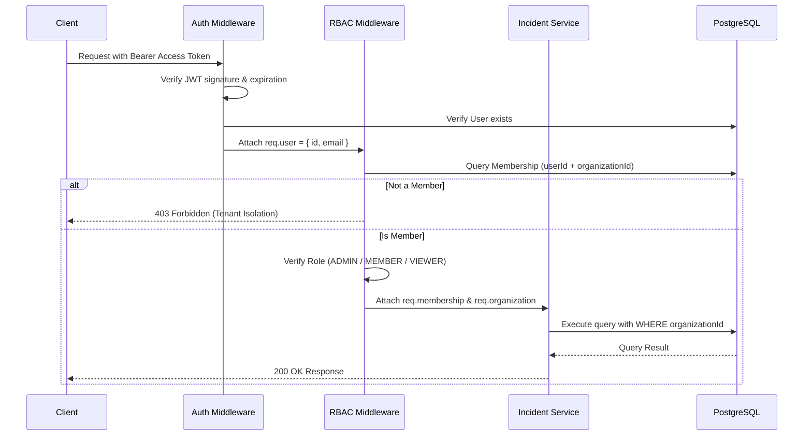
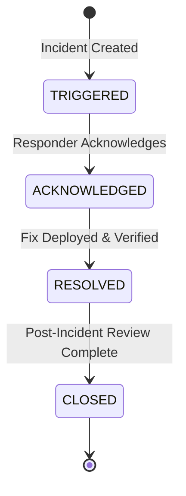

# coldTrace — Architecture Documentation

This document describes the architectural design, system boundaries, component responsibilities, and data flows of coldTrace Tier 1 MVP.

---

## 1. Architectural Style: Modular Monolith

coldTrace is built as a **modular monolith**: a single deployable Node.js process with strict internal domain separation.

```
                              [ HTTP Client / Browser ]
                                          │
                                          ▼
                         ┌─────────────────────────────────┐
                         │      Express Application        │
                         │  (JSON, Cookies, Static Assets) │
                         └─────────────────────────────────┘
                                          │
                  ┌───────────────────────┴───────────────────────┐
                  ▼                                               ▼
       [ Public Status Endpoints ]                    [ Authenticated API Routes ]
       (/api/public/status/:slug)                      (/api/auth, /api/organizations)
                  │                                               │
                  │                                               ▼
                  │                                    [ Auth & RBAC Middleware ]
                  │                                    (authenticate, requireOrgMember,
                  │                                     requireRole, validate)
                  │                                               │
                  └───────────────────────┬───────────────────────┘
                                          │
                                          ▼
                               ┌─────────────────────┐
                               │     Controllers     │
                               │  (HTTP Req / Res)   │
                               └─────────────────────┘
                                          │
                                          ▼
                               ┌─────────────────────┐
                               │  Business Services  │
                               │ (Domain Logic, ACID)│
                               └─────────────────────┘
                                          │
                                          ▼
                               ┌─────────────────────┐
                               │ Prisma 7 ORM Client │
                               │ (pg Driver Adapter) │
                               └─────────────────────┘
                                          │
                                          ▼
                               ┌─────────────────────┐
                               │ PostgreSQL Database │
                               └─────────────────────┘
```

### Why Modular Monolith?
- **Operational Simplicity**: Single repository, single process, and single database. Eliminates distributed transactions, network latency between microservices, serialization overhead, and RPC failure modes.
- **Strong Relational Integrity**: Enforces foreign keys, unique constraints, and atomic ACID transactions across entities without distributed sagas.
- **Portability and Maintainability**: Easy to run locally, test with real database fixtures, and inspect end-to-end.

---

## 2. Directory and Layer Responsibilities

| Directory | Layer | Responsibility |
|---|---|---|
| `src/routes/` | Presentation Routing | Maps HTTP paths and HTTP verbs to middlewares and controller actions. |
| `src/controllers/` | HTTP Handling | Unpacks request params/body/query, invokes services, and sends JSON status codes. No business rules or queries. |
| `src/services/` | Business & Domain Logic | Enforces lifecycle transitions, organizational access rules, database transactions, and data formatting. |
| `src/middleware/` | Cross-Cutting Concerns | JWT verification (`authenticate`), tenant authorization (`requireOrgMember`), role gates (`requireRole`), request schema validation (`validate`), 404, and centralized error handling. |
| `src/validators/` | Input Validation | Zod schemas ensuring request data conforms to structural and type constraints before reaching controllers. |
| `src/utils/` | Shared Helpers | Pure utilities for password hashing (`bcrypt`), JWT signing, token hashing, slug generation, and health calculation. |
| `src/config/` | Infrastructure Config | Shared Prisma client using `@prisma/adapter-pg`. |
| `public/` | Frontend Client | Vanilla JavaScript Single Page App and standalone Public Status Page. |

---

## 3. Authentication & Authorization Flow

coldTrace maintains a strict distinction between **Authentication** (identifying WHO the user is) and **Authorization** (verifying WHAT the user may do within a specific organization tenant).



### Token and Session Strategy
- **Access Tokens**: Short-lived JWTs (15 minutes expiration). Stateless and self-contained; verified in CPU memory without querying the database for every single endpoint.
- **Refresh Sessions**: 7-day cryptographically secure random tokens. Stored as SHA-256 hashes in the `sessions` database table and delivered via `httpOnly`, `sameSite: lax`, `secure` cookies.
- **Revocation**:
  - Logout revokes the session record in PostgreSQL (`revokedAt = now()`) and clears the cookie.
  - Refresh rotation revokes the previous session record and atomically issues a fresh token pair.
  - Access tokens expire within 15 minutes, guaranteeing bounded lifetime.

---

## 4. Multi-Tenancy and IDOR Prevention

Multi-tenancy is enforced using the **shared-database, row-level tenant discriminator** model (`organization_id` foreign keys on all tenant entities).

### Invariants:
1. **Never trust client-supplied tenant context**: A user cannot claim an organization ID without active membership verified in `memberships`.
2. **Every organizational query scopes by `organizationId`**:
   ```javascript
   // Anti-pattern (Vulnerable to IDOR):
   prisma.incident.findUnique({ where: { id: incidentId } });

   // coldTrace Standard (IDOR-safe):
   prisma.incident.findUnique({
       where: { id: incidentId, organizationId }
   });
   ```
3. **Cross-Tenant Associations are Blocked**:
   When creating or updating an incident, assignee user IDs and affected service IDs are validated against `organizationId`. A user from Organization A cannot be assigned to an incident in Organization B, and a service from Organization B cannot be linked to Organization A.

---

## 5. Permission Matrix (RBAC)

| Resource / Action | ADMIN | MEMBER | VIEWER |
|---|:---:|:---:|:---:|
| View Organization & Health Dashboard | ✓ | ✓ | ✓ |
| View Services & Details | ✓ | ✓ | ✓ |
| Create & Update Services | ✓ | ✗ | ✗ |
| Archive Service | ✓ | ✗ | ✗ |
| List Team Members | ✓ | ✓ | ✓ |
| Add Member / Update Role / Remove Member | ✓ | ✗ | ✗ |
| View Incidents & Timeline | ✓ | ✓ | ✓ |
| Create & Update Incidents | ✓ | ✓ | ✗ |
| Transition Incident Lifecycle (Acknowledge, Resolve, Close) | ✓ | ✓ | ✗ |
| Post Incident Updates (INTERNAL / PUBLIC) | ✓ | ✓ | ✗ |

---

## 6. Incident Lifecycle State Machine

coldTrace models the incident lifecycle as a deterministic, non-reversible state machine:



### Transition Invariants:
- `TRIGGERED -> ACKNOWLEDGED`: Valid.
- `ACKNOWLEDGED -> RESOLVED`: Valid.
- `RESOLVED -> CLOSED`: Valid.
- Any jump (e.g. `TRIGGERED -> CLOSED`, `TRIGGERED -> RESOLVED`) is rejected with `400 Bad Request`.
- `CLOSED -> Any`: Strictly rejected. Closed incidents are permanent historical records.
- All transitions execute in a database transaction that verifies the current status and records an `INCIDENT_STATUS_CHANGED` audit log atomically.

---

## 7. Deterministic Service-Health Calculation

coldTrace dynamically derives service health from real-time operational incidents rather than synthetic polls or external agents:

| Active Incidents Associated with Service | Derived Service Health |
|---|---|
| No active incidents | `OPERATIONAL` |
| Highest active severity is `LOW` or `MEDIUM` | `DEGRADED` |
| Highest active severity is `HIGH` or `CRITICAL` | `MAJOR_OUTAGE` |

- **Inactive statuses**: `RESOLVED` and `CLOSED` incidents do not degrade service health.
- **Overall Organization Health**: The worst health status among all active services determines the overall organization health.

---

## 8. Public Status Page Privacy Isolation

The public status page (`/status/:orgSlug` and `/api/public/status/:orgSlug`) is fully unauthenticated to allow external customers to track outages.

To prevent confidential data leaks, coldTrace strictly decouples public responses from internal representations:
- **Exposed**: Organization name, slug, overall health status, non-archived services with health pills, active public incident titles, public updates (`visibility: PUBLIC`), and timestamps.
- **Never Exposed**: Internal updates (`visibility: INTERNAL`), user email addresses, author names/IDs, user IDs, internal root-cause notes, database IDs of users, or audit logs.
